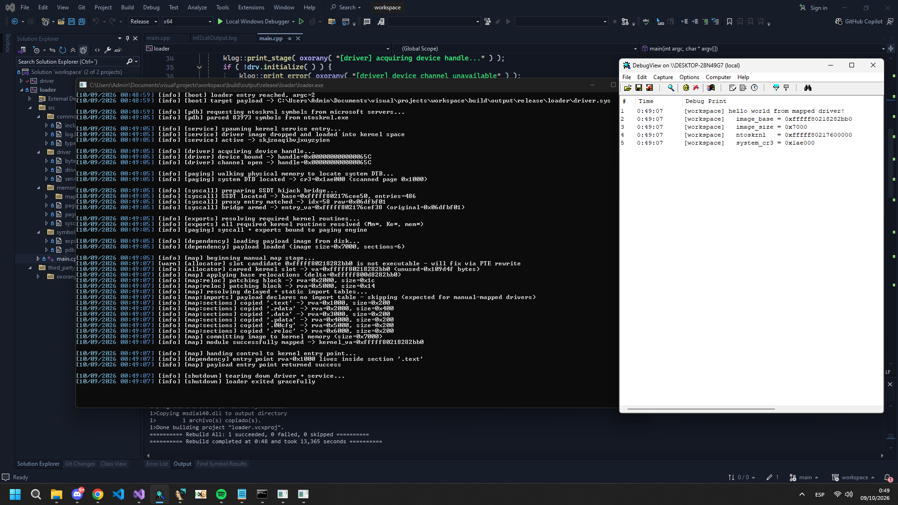

# kernel-mapper

Windows x64 kernel manual-mapping research project with a user-mode loader and a kernel-side reference driver.

<p align="center">
  
</p>

> **Research software, not a production driver framework.** Use only in an isolated laboratory on systems you own or are explicitly authorized to test. Kernel-level operations can crash the system or cause data loss.

## Overview

The repository separates the user-mode application, the reference driver and supporting documentation. Its source explores Windows internals, PE image handling and kernel symbol information. The screenshot is illustrative; it is not evidence of compatibility with every Windows version.

- **Loader:** a C++ console application, organized by component.
- **Reference driver:** a separate WDK project with a minimal kernel-side entry implementation.
- **Diagnostics:** shared console logging under `loader/src/common/`.
- **Project files:** a Visual Studio solution with Debug and Release x64 configurations.

## Repository layout

```text
kernel-mapper/
├── kernel-mapper.sln
├── README.md
├── CONTRIBUTING.md
├── SECURITY.md
├── docs/
│   ├── loader.png
│   ├── development.md
│   └── project-layout.md
├── loader/
│   ├── loader.vcxproj
│   ├── src/
│   └── third_party/
└── driver/
    ├── driver.vcxproj
    ├── driver.inf
    └── src/
        └── main.cpp
```

See [Project layout](docs/project-layout.md) for component responsibilities and [Development](docs/development.md) for toolchain requirements and project configuration.

## Platform and toolchain

The solution targets **Windows x64**, using Visual Studio 2022, the Windows SDK and the Windows Driver Kit. The loader also references the Visual Studio DIA SDK.

The driver project contains ARM64 configurations, but the solution and loader are x64-only. Those configurations do **not** establish ARM64 support for the complete project.

## Dependencies

[`oxorany`](https://github.com/llxiaoyuan/oxorany) is vendored under `loader/third_party/oxorany/`. Preserve its upstream notices and review its licensing separately. Windows development components are supplied by the SDK, WDK and Visual Studio installation.

## Contributing

Read [CONTRIBUTING.md](CONTRIBUTING.md) before submitting changes. Report vulnerabilities through the private channels described in [SECURITY.md](SECURITY.md), rather than publishing sensitive details in an issue.

## Project status

This is a research codebase. No automated test suite or compatibility matrix is provided. Building the projects does not establish that kernel-level execution is safe or supported on a particular system.

## License

No repository-wide license has been declared. Public visibility alone does not grant permission to reuse the code. Third-party components retain their own licensing terms.
